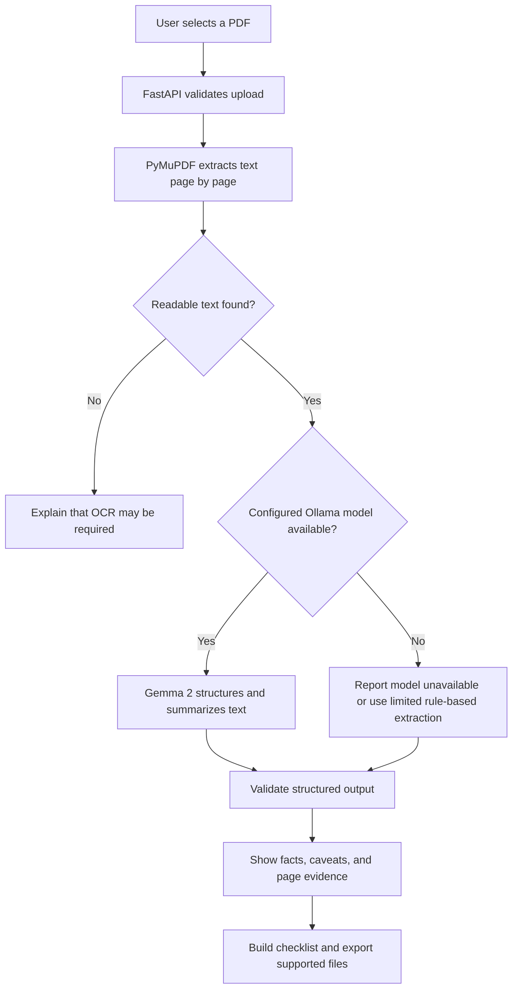
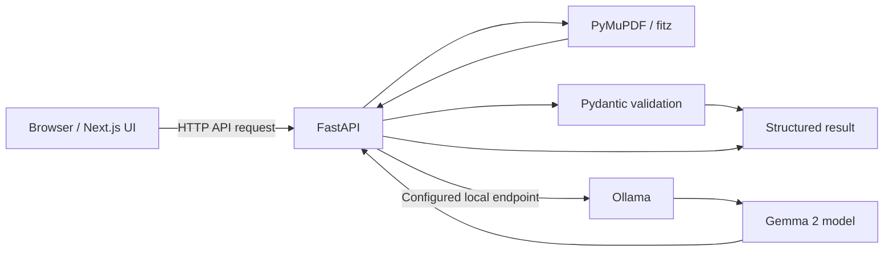

# NoticeNap 🦥

<p align="center">
  
</p>

<p align="center">
  <strong><em>Let the notice be long. Your to-do list shouldn't.</em></strong>
</p>

<p align="center">
  <a href="https://noticenap.vercel.app/"></a>
  <a href="https://dev.to/challenges/hacktoberfest-week3-2026-10-19"></a>
  
  
  <a href="LICENSE"></a>
</p>

NoticeNap is a **local-first AI assistant for long, information-heavy PDF notices**. It helps students, applicants, and job seekers find the details that matter in scholarship announcements, internship postings, recruitment circulars, examination notices, and university notifications.

Instead of manually scanning every page, a user can extract the PDF text, generate a structured summary, review important dates and requirements, and turn the findings into an action checklist. Important findings should remain traceable to their source pages so users can check the original notice before acting.

> **The idea:** one upload should make the next step clearer. NoticeNap aims to reduce the paperwork, not replace the user's judgement.

## Contents

- [Why NoticeNap?](#why-noticenap)
- [Features](#features)
- [Application screens](#application-screens)
- [How it works](#how-it-works)
- [Technology stack](#technology-stack)
- [Local-first AI and privacy](#local-first-ai-and-privacy)
- [Getting started](#getting-started)
- [Configuration](#configuration)
- [Sample notices](#sample-notices)
- [API endpoints](#api-endpoints)
- [Testing and quality checks](#testing-and-quality-checks)
- [Known limitations](#known-limitations)
- [Troubleshooting](#troubleshooting)
- [Project structure](#project-structure)
- [Design system](#design-system)
- [Security notes](#security-notes)
- [Contributing](#contributing)
- [License](#license)

## Why NoticeNap?

Official notices often distribute deadlines, eligibility conditions, fees, required documents, exceptions, and application steps across many pages. Finding those details manually takes time—and overlooking one condition can matter.

NoticeNap is designed to turn that reading task into a calmer workflow:

1. **Upload** a PDF notice.
2. **Extract** readable text while preserving page numbers.
3. **Summarize** the document and organize important information with an open-weight model when available.
4. **Verify** extracted claims against the original page and supporting text.
5. **Act** using a checklist and calendar/Markdown exports where supported.

NoticeNap is an aid for reading and organizing information, not an official source or a substitute for checking the original notice. Users should verify consequential deadlines, eligibility rules, fees, and legal requirements against the source document.

## Features

### PDF extraction

- Accepts PDF uploads (the current interface is designed for files up to 50 MB; actual limits depend on runtime configuration).
- Extracts text page by page with [PyMuPDF](https://pymupdf.readthedocs.io/).
- Preserves one-indexed page references for review.
- Detects documents with very little extractable text and can warn when OCR may be required.

### Structured document analysis

The analysis workflow is designed to organize information into useful categories:

- Short summary and document purpose
- Important dates and deadlines
- Eligibility criteria and thresholds
- Application fees or fee waivers, when stated
- Required documents
- Application steps
- Exceptions, caveats, and missing information
- Source-page references and supporting excerpts, when available

The model must not invent absent facts. Missing information should be shown as **Not found** or **Needs verification** rather than inferred as certain.

### Action list

- Organizes findings into actionable tasks.
- Supports marking tasks complete and tracking checklist progress.
- Provides filters for all, pending, and completed tasks where implemented.
- Supports Markdown (`.md`) checklist export.
- Supports iCalendar (`.ics`) export for valid dates where implemented.

### Document library

- Provides a place to revisit processed notices.
- Supports searching document metadata where available.
- Can display page count, file size, fingerprint, and processing state when these are returned by the application.
- Includes explicit empty, loading, and error states.

### Language support

The project is intended to support English, Hindi, and Marathi explanations through the configured model. Actual output quality depends on the model and deployment configuration. Always compare translated requirements, dates, names, numbers, and exceptions with the original notice.

### Local model status

The interface can display the status of the configured Ollama service and model. A status should be shown as connected only when the configured endpoint and requested model have actually been checked.

## Application screens

The current screen design was created in Google Stitch.

- **Stitch project:** [NoticeNap Workspace Interface](https://stitch.withgoogle.com/projects/14480156016592971476)
- **Live frontend:** [noticenap.vercel.app](https://noticenap.vercel.app/)
- **Source code:** [github.com/AnshMeshram/NoticeNap](https://github.com/AnshMeshram/NoticeNap)

| Screen | Route / state | Purpose |
|---|---|---|
| Dedicated Home | `/` | Introduces NoticeNap, its value, the sloth identity, and the route into the app. |
| Calm Document Desk | `/desk` | Main workspace and PDF upload flow. |
| Document Analysis | `/desk?tab=analysis` | Summary, extracted facts, evidence, and source-page navigation. |
| My Action List | `/desk?tab=actions` | Checklist, progress, and export actions. |
| Document Library | `/desk?tab=library` | Search and revisit processed documents. |
| Mobile experience | Responsive layout, below 768 px | Mobile adaptation of the same workflows, including bottom navigation. |
| Workspace alias | `/workspace` | Intended to redirect to `/desk`. |

The routes above reflect the supplied implementation notes. Confirm actual behavior against the current code if routes or query-state handling have changed.

## How it works



### Architecture



The local execution path is the intended privacy-oriented mode: the browser and backend run in the user's environment, PDF text is extracted locally, and the backend calls the locally configured Ollama service. The public hosted frontend does not automatically have access to a visitor's local Ollama process.

## Technology stack

| Area | Technology | Role |
|---|---|---|
| Frontend | Next.js, React, TypeScript | Application screens and interactions |
| Styling | Tailwind CSS | Layout, responsive styling, and theme tokens |
| Backend | Python, FastAPI | Upload handling, APIs, orchestration, and status checks |
| PDF extraction | PyMuPDF (`fitz`) | Page-by-page text extraction |
| AI inference | Ollama + Gemma 2 (`gemma2:latest`) | Local open-weight summarization and structured extraction when available |
| Output validation | Pydantic | Validate structured backend data |
| Exports | Markdown, iCalendar (`.ics`) | Save checklist actions outside the app |
| Design | Google Stitch | Approved screen designs and design references |

The code and configuration in the repository are authoritative. Versions shown in badges or older implementation notes may become stale; inspect the project dependency files for exact installed versions.

## Local-first AI and privacy

NoticeNap is designed around open-weight inference instead of requiring every document to be sent to a closed hosted-model API.

### What local-first means

When NoticeNap, FastAPI, and Ollama are configured and running locally:

1. The user chooses a PDF in the local web app.
2. The backend extracts text using PyMuPDF.
3. The backend sends extracted text to the configured local Ollama endpoint.
4. The configured model generates a structured result.
5. The application validates and displays the result with source references where available.

In this local configuration, the PDF processing path can operate without sending PDF text to a third-party inference API. Ollama and the model must already be installed and available. Initial setup and model downloads require internet access; offline operation should only be claimed after it has been tested with networking disabled.

### Public deployment caveat

The public frontend at Vercel is a web interface. It cannot directly call `localhost:11434` on the developer's machine or on a visitor's computer. For public, end-to-end AI processing, a separately reachable backend and a properly secured, available inference runtime must be configured.

Until that hosted backend/model path is deployed and verified, treat the public URL as a frontend preview rather than evidence that cloud-based extraction and inference work end to end.

### Fallback behavior

The implementation notes describe a rule-based fallback for times when Ollama is unavailable. A deterministic fallback is not equivalent to model-based summarization or translation. The UI should identify which mode generated the result and must not label a pattern-based extraction as an AI summary.

## Getting started

These instructions reflect the project structure and commands in the supplied implementation notes. If a path differs in the current checkout, confirm it in the repository before running the corresponding command.

### Prerequisites

- Node.js 20 or newer
- Python 3.11 or newer
- npm
- Ollama: [ollama.com/download](https://ollama.com/download)
- Sufficient RAM/CPU/GPU resources for the selected model

### 1. Clone the repository

```bash
git clone https://github.com/AnshMeshram/NoticeNap.git
cd NoticeNap
```

### 2. Set up the model

Install Ollama, then pull the configured model:

```bash
ollama pull gemma2
```

Start the Ollama service in its own terminal if it is not already running:

```bash
ollama serve
```

Confirm the model is available:

```bash
ollama list
```

The default local Ollama endpoint is typically `http://127.0.0.1:11434`. The application must use the same endpoint and model name that are configured in its environment/settings.

### 3. Install backend dependencies

From the repository root:

```bash
python -m venv .venv
```

Activate the virtual environment.

Windows PowerShell:

```powershell
.\.venv\Scripts\Activate.ps1
```

macOS/Linux:

```bash
source .venv/bin/activate
```

Install backend dependencies:

```bash
pip install -r backend/requirements.txt
```

### 4. Configure the backend

Inspect the repository's environment example before creating a local `.env` file. Add only the variables actually read by the current backend code. Never commit `.env` files, model credentials, or personal document data.

The local configuration must point the backend to the local Ollama service and the intended model. Do not assume the production Vercel frontend can use local loopback URLs.

### 5. Start the backend

The supplied implementation notes specify this command:

```bash
python -m uvicorn backend.main:app --host 127.0.0.1 --port 8000 --reload
```

If the application entry point is different in the current checkout, inspect the FastAPI module and update the command accordingly. When the backend starts, its interactive API docs should normally be available at:

```text
http://127.0.0.1:8000/docs
```

### 6. Install and start the frontend

Open another terminal at the repository root:

```bash
cd frontend
npm install
npm run dev
```

Open [http://localhost:3000](http://localhost:3000).

For the intended local AI workflow, make sure the frontend API client points to the local FastAPI server, the FastAPI server is running, and Ollama has the configured model available.

## Configuration

Configuration names and defaults must match the current source code. The following items are part of the documented architecture; verify the actual variable names in the backend and frontend environment examples before setting them.

| Setting | Expected purpose | Typical local value |
|---|---|---|
| FastAPI base URL | Frontend API destination | `http://127.0.0.1:8000` or the API base expected by the client |
| Ollama base URL | Backend's model endpoint | `http://127.0.0.1:11434` |
| Ollama model | Model identifier | `gemma2:latest` or the identifier returned by `ollama list` |
| CORS origin(s) | Permitted browser origins | Local frontend origin, for example `http://localhost:3000` |
| Maximum upload size | PDF upload limit | 50 MB if that is the active backend configuration |

Do not copy this table verbatim into an `.env` file. Find the exact keys expected by the current code first.

## Sample notices

The implementation notes describe a sample-notice generator at `samples/generate_sample_notices.py`. If that script is present in the repository, run:

```bash
python samples/generate_sample_notices.py
```

The documented examples are:

- `Rhodes_Scholarship_2025.pdf`
- `Civil_Services_Exam_Notice.pdf`
- `Research_Fellowship_PDF.pdf`

These are test fixtures, not current official notices. Do not use sample dates, amounts, or eligibility details as real application guidance. Verify the generator's output and location in the current repository before relying on the listed filenames.

## API endpoints

The supplied architecture describes the following endpoints. Use the running API documentation at `/docs` as the source of truth for the exact methods, request schemas, and response schemas.

| Endpoint | Intended purpose |
|---|---|
| `POST /api/documents/extract` | Upload a PDF and start extraction/analysis, if registered in the current backend |
| `GET /api/system/status` | Report backend/model status, if registered in the current backend |

The full route inventory should be derived from the actual FastAPI router. Do not assume these paths are available on the public deployment merely because they exist in source code.

## Testing and quality checks

Run the checks supported by the repository. The implementation notes report the following commands:

```bash
python -m pytest backend/test_backend.py -v
```

```bash
cd frontend
npm run lint
npx tsc --noEmit
npm run build
```

The last development handoff reported 5/5 backend tests passing, zero ESLint errors/warnings, zero TypeScript errors, and a successful Next.js production build. These are **reported development-run results**, not a guarantee that every environment or the current deployed site passes. Re-run the commands after changing code, dependencies, or configuration.

### Recommended functional test matrix

| Test | Expected behavior |
|---|---|
| Valid, text-based PDF | Text is extracted with correct page references. |
| Multi-page PDF | Page boundaries and references remain accurate. |
| Missing date/eligibility | Result says `Not found` or `Needs verification`; it does not invent a value. |
| Scanned/image-only PDF | Application explains that OCR may be required if OCR is not configured. |
| Invalid/non-PDF file | Upload is rejected with a clear error. |
| Ollama unavailable | UI reports model unavailable and distinguishes fallback extraction from model inference. |
| Missing model | UI reports the configured model is unavailable. |
| Malformed model output | Output is validated; invalid structures are not presented as successful analysis. |
| Hindi/Marathi output | Meaning, dates, numbers, names and exceptions remain faithful to the source. |
| Calendar export | A valid `.ics` file is produced only for dates that passed validation. |

## Known limitations

- **Local versus hosted inference:** a public web deployment cannot automatically use the visitor's local Ollama daemon. A working public AI workflow requires a separately reachable backend and a secured model runtime.
- **Model output can be wrong:** always verify important facts against the source PDF. Evidence links help review claims but do not guarantee that the interpretation is correct.
- **Scanned PDFs:** PyMuPDF text extraction alone may not read image-only pages. OCR is required for those documents unless a working OCR path is installed.
- **Language quality:** English, Hindi, and Marathi support depends on the selected model, prompt, and tests. Do not assume equal quality across languages.
- **Rule-based fallback:** pattern extraction may identify some dates or phrases but is not equivalent to model-based summarization or translation.
- **Deployment state:** the frontend is deployed at Vercel, but its end-to-end AI capabilities depend on the backend and inference configuration actually available at runtime.

## Troubleshooting

### `Failed to fetch`

1. Check that FastAPI is running and reachable from the environment where the frontend is running.
2. Inspect browser DevTools → Network to identify the exact failed URL and response.
3. Check that the frontend API base URL matches the expected route prefix.
4. Check CORS configuration for the exact browser origin.
5. Remember that `localhost` on a remote service does not refer to your computer.

### Ollama shows disconnected/offline

1. Start Ollama using `ollama serve` if required by the installation.
2. Run `ollama list` and verify the configured model exists.
3. Check the local status endpoint supported by the installed Ollama version.
4. Confirm the backend points to the correct Ollama host and port.
5. For public deployment, use a deliberately configured, secured model runtime; do not assume local Ollama is remotely reachable.

### Summary is empty or incomplete

1. Check whether the PDF contains selectable text or is scanned.
2. Check the extraction result and page count before inference.
3. Inspect model availability, timeout logs, and structured-output validation.
4. Test a short PDF to distinguish extraction problems from context-length or inference problems.
5. Verify every key fact against the original source pages.

### A deadline or fact looks wrong

Do not rely on the generated result until checked against the original notice. Report the incorrect field along with its source page and supporting excerpt so extraction, prompting, or validation can be improved.

## Project structure

The following is the intended high-level layout described in the implementation notes. Inspect the current checkout for exact filenames, because modules may move as the project evolves.

```text
NoticeNap/
├── frontend/
│   ├── app/                     # Next.js pages and metadata/icons
│   ├── public/                  # Logo, sloth art, manifest and static assets
│   └── ...                      # Components, styles and API client
├── backend/
│   ├── requirements.txt         # Python dependencies
│   ├── test_backend.py          # Backend tests (if present)
│   └── ...                      # FastAPI app, extraction, model integration
├── samples/                     # Sample notice generator (if present)
├── README.md
└── LICENSE
```

## Design system

NoticeNap uses a cozy editorial visual identity inspired by a calm paper desk and a sleepy sloth. The design should remain restrained and readable instead of resembling a generic AI dashboard.

| Token | Value | Use |
|---|---|---|
| Background / surface | `#f8fbef` | Warm paper workspace |
| Primary | `#0a3626` | Deep-green text and key accents |
| Primary container | `#244d3b` | Primary controls |
| Soft sage | `#dae3d0` | Active navigation and quiet surfaces |
| Warm surface | `#f2f5ea` | Sidebar and secondary background |
| White surface | `#ffffff` | Paper-like content areas |
| Outline | `#c1c8c2` | Fine dividers and borders |
| Muted amber | `#f0bf63` | Standby or caution accents |

**Typography:** Newsreader for editorial headings, Manrope for body/UI copy, and JetBrains Mono for technical statuses and compact source identifiers.

The sloth mascot represents the product's idea: less effort spent hunting through paperwork. Use the photograph or detailed illustration at larger sizes and a simplified vector mark for favicons and small app icons.

## Security notes

- Never commit `.env`, API keys, passwords, or private document samples.
- Treat uploaded PDFs and extracted text as untrusted input.
- Do not execute instructions contained inside a PDF.
- Validate file type, size, page count, and extracted output on the backend.
- Do not expose an unauthenticated public Ollama endpoint or tunnel.
- Avoid logging full PDF contents or sensitive personal information.
- Be explicit about whether a document is processed locally or by a hosted service.
- Do not claim encryption, total privacy, or offline operation unless the full relevant behavior is implemented and verified.

## Contributing

Contributions that improve extraction reliability, evidence traceability, accessible UI, multilingual output, and local-first operation are welcome.

1. Fork the repository.
2. Create a branch: `git checkout -b fix/short-description`.
3. Make a focused change and add or update tests.
4. Run the relevant tests, lint, type checks, and build.
5. Review the diff for secrets and unrelated changes.
6. Open a pull request describing the problem, implementation, and verification results.

For bug reports, include the relevant route, expected behavior, actual behavior, sample document characteristics (without private content), and any safe error message. Do not attach sensitive personal documents unless you have permission and have removed private information.

## License

This project states an MIT license. See [`LICENSE`](LICENSE) for the complete license text. Ensure that the license file exists in the repository and matches this statement.

## Acknowledgements

- [Google Stitch](https://stitch.withgoogle.com/projects/14480156016592971476) — design workflow and screen references.
- [Ollama](https://ollama.com/) — local model serving.
- [Gemma](https://ai.google.dev/gemma) — open-weight model family.
- [PyMuPDF](https://pymupdf.readthedocs.io/) — PDF text extraction.
- [FastAPI](https://fastapi.tiangolo.com/) — backend API framework.
- [Next.js](https://nextjs.org/) — frontend framework.

---

<p align="center">
  <strong>Take the notice one page at a time. 🦥</strong><br />
  <sub>Built for Hacktoberfest 2026 — Week 3: Slow and Steady.</sub>
</p>
